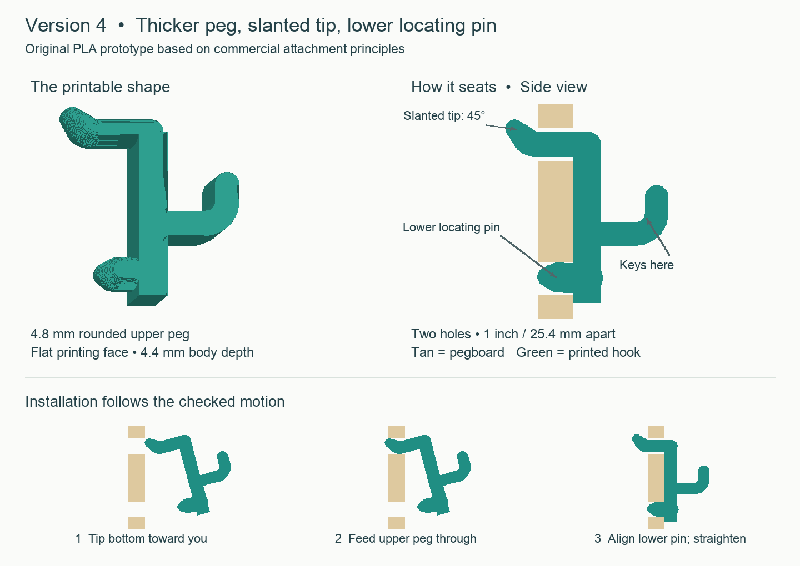

# Bambu H2S 3D Printing Designs

Original pegboard designs, printable files, editable source, and fit checks for a Bambu Lab H2S.

## Pegboard Design 1

[Open the design folder](pegboard-design-1/) for the current slanted key hook. Its 4.8 mm rounded upper peg and lower locating pin are designed for a nominal 1/4 inch round-hole pegboard with holes 1 inch apart. The lower pin should reduce swiveling; physical fit and strength still need testing.



1. Download [the Bambu Studio project](pegboard-design-1/pegboard-design-1-H2S-PLA-Wood.3mf).
2. Open it as a project and retain its settings.
3. Click **Slice Plate**, review the preview, then **Print Plate** and select the loaded PLA Wood spool.

Configured for an H2S with a stock 0.4 mm nozzle, Textured PEI plate, and Bambu PLA Wood. The saved project sliced successfully in Bambu Studio 2.8.2.61: about **9 minutes**, **1.65 g model filament**, and no plate warnings. Actual startup and purge use may vary.

See [printing and installation instructions](pegboard-design-1/PRINT-INSTRUCTIONS.txt), [editable OpenSCAD geometry](pegboard-design-1/pegboard-design-1.scad), and [the STL](pegboard-design-1/pegboard-design-1.stl). Let the plate cool before removal. Start with a few keys. This attachment prototype is not yet a validated AirGradient mount and has no verified load rating.

## Earlier designs

The [prototype archive](archive/) retains the round, square and diamond pegs, calibration plugs, earlier AirGradient attachment tests, and thin key hooks. Each folder includes its fit status. Some earlier attachments failed physical fit; archive files are preserved for iteration history.

## Generate the current geometry

Use Python 3.9 or newer from the repository root:

```sh
python3 -m venv .venv
source .venv/bin/activate
python -m pip install -r requirements.txt
python pegboard-design-1/generate.py
```

This regenerates the STL, OpenSCAD file and geometry report in the design folder, including the insertion checks. It does not update the saved Bambu Studio project automatically; import the regenerated STL into Bambu Studio and save a new project when changing the geometry.

Archived generators in `work/` write to `outputs/`. Run `work/design_hook_v2.py` before `work/design_key_hooks_v3.py`, which depends on its geometry and motion report.

## Research and validation

[Research sources and design decisions](pegboard-design-1/research.json) distinguish published commercial dimensions from this original prototype. The Amazon products researched do not publish an exact upper mounting angle; the chosen 45 degree tip passed the modeled insertion checks.

[Geometry results](pegboard-design-1/geometry-and-motion-check.json) and [Bambu Studio slicing results](pegboard-design-1/slice-result.json) are included. Simulation checks geometry; actual pegboard tolerances, print variation, retention and durability require physical testing.
